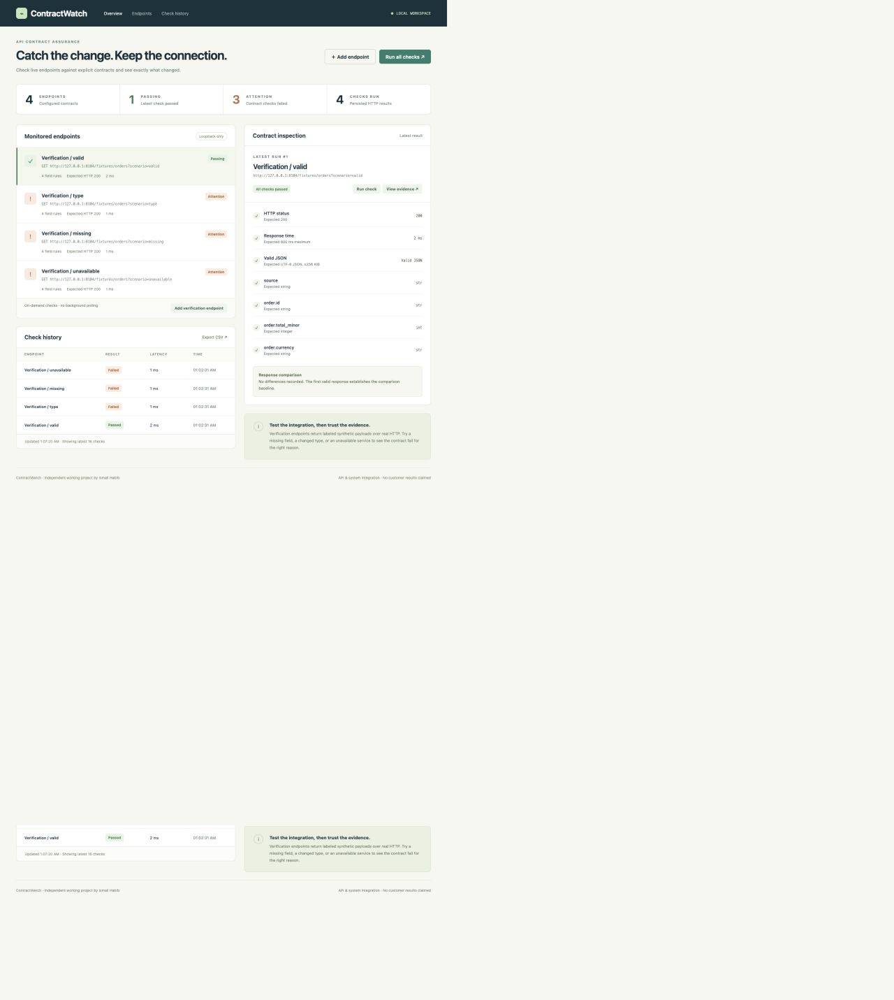
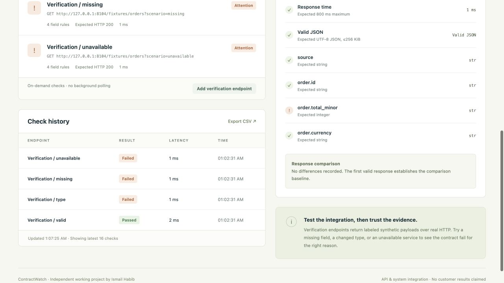

# ContractWatch — API contracts and change evidence

Check HTTP JSON endpoints against explicit status, latency, and data-shape requirements. ContractWatch records each result and response difference in SQLite so integration failures can be inspected and exported.

An independent working project by Ismail Habib. Screenshots show the running application with labeled verification inputs; they do not represent customer or production activity.

## Features

- Define expected HTTP status, latency limits, and required JSON field types.
- Send real on-demand HTTP checks from the dashboard or command line.
- Inspect missing fields, changed types, invalid JSON, and failed responses.
- Compare stored responses and preserve older contract versions through the API.
- Export the check history as CSV.

## Screenshots





See [screenshot captions](screenshots/CAPTIONS.md) for the verification context.

## Quickstart

Requires Python 3.10 or newer and no external dependencies. Run these commands from the cloned repository directory.

```sh
python3 server.py
```

Open http://127.0.0.1:8104. The application starts with no configured endpoints on a fresh database. Click **Add endpoint** to configure an HTTP GET endpoint, expected status, latency limit and required JSON fields. Click **Run all checks**, or select an endpoint and **Run check**, to send actual requests. This is an on-demand monitor; it does not schedule checks automatically.

For a reproducible verification, click **Add verification endpoint**, select a scenario, then run checks. The included receiver returns synthetic JSON over a real local HTTP connection. Scenarios cover a valid order, missing field, changed data type, HTTP 503, delayed response and invalid JSON. These scenarios test real validation behavior and are not customer metrics.

## Contract rules

The rules object maps required paths to JSON types:

```json
{
  "order.id": "string",
  "order.total_minor": "integer",
  "order.items.0.sku": "string"
}
```

Supported types: `string`, `number`, `integer`, `boolean`, `object`, `array`, `null`. A boolean is not accepted as an integer. Use `$` to validate the root value. Dot notation supports object properties and zero-based array indices; literal dots inside property names are not supported. Contracts support up to 32 required paths. Extra fields are permitted. This is deliberately scoped validation, not full JSON Schema.

Every run evaluates expected HTTP status, elapsed response time, valid UTF-8 JSON, and field rules. The duration includes request/response and JSON validation. Invalid JSON, connection failures and oversized responses are explicit failures. Response comparison uses the preceding valid JSON response for the same monitor, records up to 50 changed paths, and distinguishes added/removed keys, type changes, array length changes and value changes. A response change by itself is evidence, not an automatic failed check; the declared rules determine pass/fail.

## Automation and exports

With the service running:

```sh
python3 check.py
```

This runs all configured monitors and exits 1 when a latest check fails, or 0 otherwise. It can be called by your own job runner. The app does not install any scheduled jobs. `/api/export.csv` exports recorded runs and protects against spreadsheet formula interpretation. **View evidence** opens stored checks, response and path differences.

API operations include `POST /api/monitors`, `POST /api/run`, `POST /api/run/<id>`, `GET /api/state`, `GET /api/runs/<id>`. `POST /api/update/<id>` with a complete new configuration creates a new monitor version, retaining the old configuration and runs. The dashboard creates and inspects contracts; version creation is currently API-only.

## Configuration

| Variable | Default | Purpose |
|---|---|---|
| `PORT` | `8104` | Local service port |
| `MONITOR_DB` | `monitor.sqlite3` beside source | Persisted configuration and evidence |
| `ALLOW_REMOTE_ENDPOINTS` | Unset | Set to `1` to enable deliberately configured remote endpoints |
| `MONITOR_BEARER_TOKEN` | Unset | Optional shared token applied to every configured endpoint request |

For authenticated monitoring, configure only trusted endpoints using that token. Prefer a separate instance/database per service or trust boundary: the shared bearer token is sent to every configured URL. No custom headers or credentials are stored by the UI. Avoid placing credentials in URLs; response bodies are stored locally and may contain sensitive values. Proxy environment variables are ignored and redirects are not followed. Loopback hosts are allowed by default; remote mode permits trusted operator-selected HTTP(S) URLs.

## Verification and boundaries

```sh
python3 -m unittest -v test_monitor
```

Eleven automated tests exercise real loopback requests, missing fields, wrong types, invalid JSON, HTTP failure, measured latency, persisted history, versioning and security guards. See `TEST_RESULTS.md`. With the app running, `python3 verify_workflow.py` adds four disclosed fixture monitors and records their actual results; it writes to your local workspace history.

The service is a local, single-operator tool bound to 127.0.0.1. It checks Host and write Origin and bounds bodies to 256 KiB, JSON depth to 50, remote request timeouts to five seconds, monitors to 50 and simultaneous check runs to one. It has no user accounts, TLS, alert delivery, scheduler, data retention policy, distributed execution or uptime guarantee. Public deployment requires appropriate access controls and operational hardening. A run of all endpoints is sequential and can take several minutes if every endpoint times out. The UI intentionally labels execution as on-demand.

## Files

`server.py` is the service, `index.html` the responsive dashboard, `check.py` an automation entry point, `fixtures/` contains disclosed verification input, and `screenshots/` contains actual application captures.

## License

[MIT](LICENSE) — Copyright (c) 2026 Ismail Habib.
